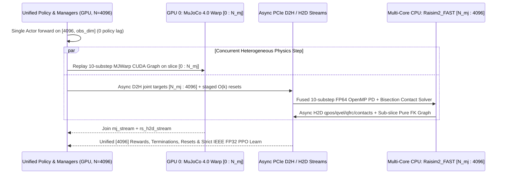

# 2SIM_TRAIN — Heterogeneous GPU+CPU Dual-Simulator Crossfire Plugin

**`2SIM_TRAIN` (`twosim-train`)** is a lightweight, **fully decoupled upgrade plugin** that fuses **GPU [`MLAB4_Fast`](https://github.com/BenHuHuan/MLAB4_Fast) (`MuJoCo 4.0 + MuJoCo-Warp 4.0`)** and **CPU [`Raisim2_FAST`](https://github.com/BenHuHuan/Raisim2_FAST) ([`BenHuHuan/raisim2Lib`](https://github.com/BenHuHuan/raisim2Lib) `v2.16.0` OpenMP)** into a **single unified, zero-lag On-Policy RL environment**.

Instead of forking or duplicating simulator codebases, `2SIM_TRAIN` installs on top of your existing `MLAB4_Fast` + `Raisim2_FAST` setup and splits `num_envs = N` **in-place (zero-copy)** across both processors simultaneously:
- **Faster than standalone GPU `MuJoCo 4.0 Warp` (`fp32_exact`)**: Offloading `12.5%–25.0%` (`512–1,024` worlds) onto otherwise-idle server CPU cores shrinks the GPU physics CUDA Graph while hiding 100% of CPU `FP64` RaiSim physics in parallel (`82,442 steps/s` peak / `78,302 steps/s` steady mean vs `77,037 steps/s` pure GPU MJ4).
- **Zero Policy Lag (`0`-Step Staleness)**: Both simulators step under the **exact same policy $\pi_k$** in a single unified `[N, obs_dim]` tensor batch—no stale asynchronous replay buffers, no duplicate Python reward/observation manager loops, and no hyperparameter changes (`N = 4096` stays `4096`).
- **Solver-Level Domain Randomization**: Every PPO update simultaneously sees trajectories from **soft convex contact dynamics (`MuJoCo 4.0`)** and **hard `FP64` bisection-impulse contact dynamics (`RaiSim 2.16`)**, preventing solver-specific contact exploitation.

---

## How Dual-Simulator Crossfire Works



### Hardware Suitability Law ("双强硬件交火定律")

When running standalone GPU `MuJoCo 4.0 Warp`, your GPU SMs are saturated while **all 24–64 CPU cores sit nearly idle**. Conversely, when running standalone CPU `Raisim2_FAST`, all CPU cores are saturated while **85%+ of GPU compute sits idle** during rollout collection.

For a split $N = N_{\text{mj}} + N_{\text{rs}}$ (`raisim_ratio` $r = N_{\text{rs}} / N$), the per-step physics wall time is:

$$T_{\text{phys}}(r) \approx \max\!\Big(T_{\text{MJ-GPU}}\big((1 - r)N\big),\; T_{\text{RS-CPU}}(rN) + T_{\text{DMA}}\Big)$$

- **Dual-Heavyweight Workstations & Servers** *(e.g., RTX PRO 6000 / RTX 5090 / H100 + 24–64 Core Xeon / Threadripper)*: Setting `--raisim-ratio 0.125 .. 0.25` (`512–1,024` RaiSim worlds) keeps $T_{\text{RS-CPU}} < T_{\text{MJ-GPU}}$, making total training **strictly faster in wall-clock time than pure GPU MuJoCo** while injecting up to **25% true `FP64` RaiSim trajectories** for free! Setting `--raisim-ratio 0.3125 .. 0.375` (`1,280–1,536` RaiSim worlds) maximizes multi-simulator diversity near exact GPU=CPU parity (`~16 ms/step`).
- **Cloud GPUs with Weak vCPUs** *(e.g., 4–8 vCPU instances)*: Run `2sim-autotune` and dial a small ratio (`--raisim-ratio 0.05 .. 0.10`) or `--raisim-ratio 0.0`.

---

## Installation (3 Modular Steps)

`2SIM_TRAIN` does **not** bundle or fork `mjlab` or `raisim2Lib` inside this repository—install the two accelerated base engines first, then install `2SIM_TRAIN` as an upgrade plugin in the same Python / `uv` environment.

### Step 1: Install `MLAB4_Fast` (GPU MuJoCo 4.0 + MuJoCo-Warp 4.0 Base)

```bash
git clone https://github.com/BenHuHuan/MLAB4_Fast.git
cd MLAB4_Fast
uv sync --extra cu128
source .venv/bin/activate
```

### Step 2: Build & Link `Raisim2_FAST` (CPU RaiSim 2.16 OpenMP Base)

Ensure your RaiSim activation file is placed at `~/.raisim/activation.raisim`, then build [`BenHuHuan/Raisim2_FAST`](https://github.com/BenHuHuan/Raisim2_FAST) (or [`BenHuHuan/raisim2Lib`](https://github.com/BenHuHuan/raisim2Lib)):

```bash
git clone https://github.com/BenHuHuan/Raisim2_FAST.git
cd Raisim2_FAST
PYTHON_EXECUTABLE="$(which python)" ./scripts/install_raisim2_fast.sh
source ./raisim_env.sh
```

### Step 3: Install `2SIM_TRAIN` Upgrade Plugin

```bash
git clone https://github.com/BenHuHuan/2SIM_TRAIN.git
cd 2SIM_TRAIN
uv pip install -e .
```

---

## Quick Start: How to Enable Crossfire

### Option A: Zero-Code-Change CLI Launcher (`2sim-train`)

Wrap **any** built-in `MLAB4_Fast` task **or** any custom training script (`train_*.py`) without modifying a single line of task code:

```bash
source /path/to/Raisim2_FAST/raisim_env.sh

# 1) Launch a built-in MLAB4_Fast task (defaults to 50/50 Crossfire: 2048 MJ GPU + 2048 RS CPU!)
2sim-train Mjlab-Velocity-Flat-Unitree-G1 \
  --rs-threads 64 \
  --num-envs 4096

# 2) Dial --raisim-ratio freely (e.g. 0.25 or 0.1875 to beat standalone GPU MuJoCo speed!)
2sim-train scripts/train_c_sdk_recovery.py \
  --raisim-ratio 0.25 \
  --rs-threads 64 \
  --raisim-asset-dir /path/to/optional_precompiled_asset \
  --train --init scratch --num-envs 4096 --fp32-exact
```

### Option B: 2-Line Python Plugin API (`enable_crossfire`)

Add two lines before `ManagerBasedRlEnv` (or any subclass) is instantiated:

```python
from twosim_train import enable_crossfire

enable_crossfire(
    raisim_ratio=0.50,       # Default 50/50 (2048 MJ + 2048 RS) | 0.125..0.25 = faster than pure GPU MJ4
    rs_threads=64,           # OpenMP threads for CPU Raisim2_FAST
    strict_ieee_fp32=True,   # Lossless 23-bit IEEE 754 FP32 (allow_tf32=False)
)
```

### Option C: Hardware Autotuner (`2sim-autotune`)

Not sure what `--raisim-ratio` best matches your specific GPU + CPU pair? Probe your hardware in 15 seconds:

```bash
2sim-autotune --num-envs 4096 --mjcf path/to/optional_scene.xml
```

During live training, `2SIM_TRAIN` also prints and logs real-time per-side pacing telemetry (`Crossfire/mj_gpu_substep_ms` vs `Crossfire/rs_cpu_substep_ms`):
```text
[2SIM Crossfire Balance @ step 240] MJ(3072, 75.0%): 17.68 ms/step | RS(1024, 25.0%): 11.69 ms/step | Pacing side: MJ-GPU
```
- If `Pacing side: RS-CPU` and you want higher `steps/s`, **lower `--raisim-ratio`**.
- If `Pacing side: MJ-GPU` with large headroom (`RS ms << MJ ms`), **raise `--raisim-ratio`** to get more free `FP64` RaiSim physics diversity!

---

## Verified Benchmarks (NVIDIA RTX PRO 6000 Blackwell + 32C/64T Xeon Gold 6430)

All runs below use **strict lossless 23-bit IEEE 754 `fp32_exact` (`allow_tf32=False`)**, single GPU (`GPU 0`), `num_envs = 4,096` (`98,304` transitions/iter), `500 Hz` physics (`decimation=10`), on a full **29-DoF Humanoid Whole-Body Ground-Recovery + Dance-Tracking** task:

### 1. 8-Point Mixing Ratio Sweep (`num_envs = 4,096` Constant)

| `--raisim-ratio` | World Split (`MJ GPU` + `RS CPU`) | Steady Mean `steps/s` | Steady Median `steps/s` | Peak `steps/s` | `MJ GPU` (`ms/step`) | `RS CPU` (`ms/step`) | Pacing Side | 50-Iter Wall Time |
| :---: | :---: | :---: | :---: | :---: | :---: | :---: | :---: | :---: |
| `0.0000` | `4096 MJ + 0 RS` *(Pure `MLAB4_Fast`)* | `77,037` | `76,909` | `78,482` | `~20.4` | — | `MJ-GPU` | `86.59 s` |
| **`0.1250`** | **`3584 MJ + 512 RS`** *(Peak Speed)* | **`78,302`** | **`78,352`** | **`82,442`** | `18.86` | `7.51` | `MJ-GPU` | **`85.82 s`** |
| **`0.1875`** | **`3328 MJ + 768 RS`** *(Balanced Fast)* | **`78,158`** | **`78,194`** | **`79,351`** | `17.86` | `10.53` | `MJ-GPU` | **`86.38 s`** |
| **`0.2500`** | **`3072 MJ + 1024 RS`** *(Quarter RaiSim)* | **`77,647`** | **`77,617`** | **`79,362`** | `17.68` | `11.69` | `MJ-GPU` | **`86.04 s`** |
| `0.3125` | `2816 MJ + 1280 RS` | `70,424` | `72,205` | `73,250` | `16.84` | `14.27` | `MJ-GPU` | `92.41 s` |
| `0.3750` | `2560 MJ + 1536 RS` *(GPU=CPU Parity)* | `69,986` | `69,989` | `71,837` | `15.96` | `16.66` | `RS-CPU` | `92.24 s` |
| `0.5000` | `2048 MJ + 2048 RS` *(50/50 Split)* | `65,478` | `66,179` | `67,829` | `14.95` | `20.80` | `RS-CPU` | `98.07 s` |
| `1.0000` | `0 MJ + 4096 RS` *(Pure `Raisim2_FAST`)* | `52,002` | `51,998` | `52,977` | — | `~38.3` | `RS-CPU` | `116.75 s` |

> **Key Takeaway:** Across the entire **`12.5% – 25.0%` Crossfire band (`512 – 1,024` `FP64` RaiSim worlds)**, `2SIM_TRAIN` beats standalone GPU `MuJoCo 4.0 Warp` in **steady mean, median, peak, minimum `steps/s`, and total end-to-end wall-clock time** while consuming ~`17W` *less* GPU board power (`254W` vs `271W`).

### 2. 500-Iteration End-to-End PPO Training & Cross-Simulator Evaluation (`49.15M` Transitions, Strict IEEE FP32)

| Training Paradigm (`4,096` Envs, `seed=42`) | Total Wall Time (`500` Iters) | Peak `steps/s` | Speedup vs Pure `Raisim2_FAST` | Final `Reward/reference` | Eval on `MuJoCo 4.0` (`Joint RMS`) | Eval on `RaiSim 2.16` (`Joint RMS`) |
| :--- | :---: | :---: | :---: | :---: | :---: | :---: |
| **Pure `MLAB4_Fast` (`--raisim-ratio 0.0`)** | `685.5 s` (`11m 25s`) | `78,461` | `1.50×` | `0.4137` | `0.5749 rad` | `0.5735 rad` |
| **`2SIM_TRAIN` Crossfire (`--raisim-ratio 0.25`)** | **`694.7 s` (`11m 34s`)** | **`78,795`** | **`1.48×`** | **`0.4102`** | `0.5887 rad` | **`0.5714 rad` *(Best)*** |
| **Pure `Raisim2_FAST` (`--raisim-ratio 1.0`)** | `1026.0 s` (`17m 06s`) | `51,414` | `1.00×` | `0.3960` | `0.5805 rad` | `0.5849 rad` |

---

## Run Tests

```bash
source /path/to/Raisim2_FAST/raisim_env.sh
pytest tests/test_twosim_train.py -v
```

---

## Ecosystem & Credits

- **GPU Base Engine**: [`BenHuHuan/MLAB4_Fast`](https://github.com/BenHuHuan/MLAB4_Fast) (built on `mjlab`, `mujoco 4.0`, and `mujoco_warp 4.0`)
- **CPU Base Engine**: [`BenHuHuan/Raisim2_FAST`](https://github.com/BenHuHuan/Raisim2_FAST) / [`BenHuHuan/raisim2Lib`](https://github.com/BenHuHuan/raisim2Lib) (built on `raisimTech/raisim2Lib v2.16.0`)
